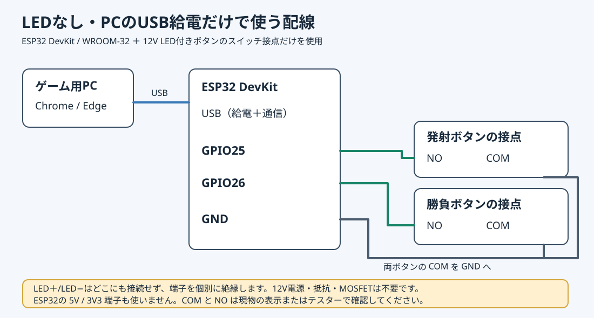

# ESP32筐体コントローラー

対象は **ESP32 DevKit / WROOM-32** と、12V LED付き押しボタン2個です。**LEDを点灯させなくてもボタン操作はできます。** 標準構成ではスイッチ接点だけを使い、ESP32はPCのUSBから給電します。発射・勝負だけをボタンで操作し、開始、追加投入、計数、次のお客さんは係員のキーボードで行います。



## 用意するもの

- ESP32 DevKit / WROOM-32、PCとの通信用USB**データ**ケーブル
- 12V LED付き押しボタン ×2（マイクロスイッチ端子 **COM / NO** だけを使用）
- 配線材・端子台・LED端子を個別に絶縁する部材

LEDなしなら、12V電源・MOSFET・抵抗は不要です。ボタンのLED＋/LED−はそれぞれ接続せず絶縁します。ESP32の5V/3V3端子も使いません。

## LEDなしの接続表

| ESP32 | 接続先 |
| --- | --- |
| USBコネクター | PCのUSBポート（ESP32の給電とシリアル通信） |
| GPIO25 | 発射ボタンのマイクロスイッチ **NO** |
| GPIO26 | 勝負ボタンのマイクロスイッチ **NO** |
| GND | 両マイクロスイッチの **COM** |

図は [wiring_buttons_only.svg](wiring_buttons_only.svg) です。スケッチは内部プルアップを使うため、外付けのプルアップ抵抗も不要です。COM–NOが押したときだけ導通することを、現物の端子表示かテスターで確認してください。NC端子は使いません。未接続のGPIO27/14はLED制御出力として動いても支障ありません。

## LEDも点灯させる場合（後から追加可能）

この節はオプションです。12V電源を用意できたときは [LED付き配線図](wiring.svg) に従って追加できます。同じスケッチをそのまま使えます。5Vを12V仕様のLEDにつないでも、仕様どおりの点灯は保証できません。LEDへESP32 GPIOから直接給電しないでください。

追加で用意するもの：

- 安定化12V DC電源 ×1（2灯の合計消費電流を供給できるもの）、適合する電源コネクター
- ロジックレベルNチャネルMOSFET AO3400A ×2（SOT-23変換基板に載せると配線しやすい）
- 220 Ω 抵抗 ×2、100 kΩ 抵抗 ×2、追加の配線材・端子台

LEDの定格は指定商品の **12V** 表示に合わせています。LEDの必要電流と抵抗内蔵の詳細は現物で確認し、12V対応が確認できるまで通電しないでください。LEDに直列抵抗を追加するかは現物の仕様に合わせます。MOSFETのゲートだけで12V LEDを制御し、ESP32 GPIOからLEDに直接給電しません。

### LED付きの追加接続表

| ESP32 / 電源 | 接続先 |
| --- | --- |
| GND | 12V電源 **0V**、Q1/Q2の **Source (S)**、各100 kΩのGND側（ボタンのCOMも引き続きGND） |
| GPIO27 | 220 Ωを介してQ1 **Gate (G)**（発射LED） |
| GPIO14 | 220 Ωを介してQ2 **Gate (G)**（勝負LED） |
| 12V電源 + | 両ボタンの **LED＋** |
| 発射ボタン LED− | Q1 **Drain (D)** |
| 勝負ボタン LED− | Q2 **Drain (D)** |
| Q1/Q2 Gate (G) | 各100 kΩを介してGND（プルダウン） |

**12VをESP32のGPIO、3V3、5V端子に接続しないでください。** 配線前にUSBと12V電源を抜き、実際のLED端子の極性と、MOSFETのG/D/Sを確認します。

## 書き込み

このスケッチは **Arduino IDE 2.3.10**、**esp32 by Espressif Systems 1.0.6** で検証しました。IDEで [pachikoma_controller/pachikoma_controller.ino](pachikoma_controller/pachikoma_controller.ino) を開きます。ボードを **ESP32 Dev Module**、ポートを接続したESP32のCOMポートに設定し、「書き込み」を押してください。ボードによっては書き込み開始時に **BOOT** ボタンを押す必要があります。

ESP32のボードパッケージがIDEでまだ表示されない場合は、`ファイル → 基本設定 → 追加のボードマネージャのURL` に下記を登録し、`ツール → ボード → ボードマネージャ` から **esp32 by Espressif Systems** をインストールします。

```text
https://espressif.github.io/arduino-esp32/package_esp32_index.json
```

Arduino IDEのシリアルモニターは **115200 baud** です。起動時に `PACHIKOMA,READY,1` が出ます。各ボタンを押すと `BTN,FIRE` / `BTN,CHALLENGE` が1回ずつ出ます。ブラウザ接続時はシリアルモニターを閉じてください（同じCOMポートを同時には開けません）。

LEDを追加した場合は、12V電源を入れた後、シリアルモニターの改行設定を「改行」または「CRおよびLF」にし、`LED,1,0` を送ると発射LEDだけ、`LED,0,1` で勝負LEDだけ点灯します。`LED,0,0` で両方消灯します。通信が止まると約2.5秒で自動消灯します。

## ゲームで使う

1. ESP32をPCのUSBに接続します。LEDなしなら、これだけで給電できます。
2. `Pachikoma-Play.bat` でゲームを起動し、**Chrome または Edge** でローカルページを開きます。
3. 画面左上の **ESP32 接続** を押し、ESP32のUSBシリアルポートを選びます。`ESP32: 接続済み` になれば準備完了です。以前許可したポートが1つなら自動で再接続を試みます。
4. 係員が **Space** で開始します。最初のキー操作で音も有効になります。プレイヤーは発射ボタンと勝負ボタンを使います。

係員のキーは **Space**（開始、予備の発射）、**A**（追加投入）、**B**（計数、確認画面でもう一度B）、**R**（結果後に次のお客さん）、**Esc**（戻る・取り消し）です。**C** は勝負ボタンの予備キーです。LEDを追加した場合、発射可能時に発射側が点灯し、勝負可能時に勝負側が点灯します。勝負の宣言中は勝負LEDが点滅します。通信が約2.5秒途切れたらLEDは消灯します。

接続できないときは、USBケーブルがデータ対応か、ボードにCOMポートが現れるか、Arduinoシリアルモニターなどがポートを開いていないかを確認してください。画面側の接続状態も表示されます。ESP32のUSBシリアル変換チップによってはWindows用ドライバーが必要です。ドライバーは基板のチップ刻印を確認してから、その製造元のものを使ってください。

## 動作確認

ブラウザ連携の自動テストは `node work/game_demo/play/cabinet_serial_test.mjs` で実行できます。2026年10月17日、ESP32 DevKit / WROOM-32をPCのUSBに接続し、2個の実ボタンから `BTN,FIRE` / `BTN,CHALLENGE` を受信、Chromeのゲーム画面で勝負と発射が反映されることを確認しました。オプションの12V LEDは未接続のため、点灯動作は未検証です。
